# Как устроен Python Roguelike

Путеводитель по текущему коду, подготовлен 20 октября 2026 года. Исходные файлы игры не изменены. Схемы описывают существующее поведение, включая отличия от комментариев и старого ARCHITECTURE.md.

Начните со схем 1–4, затем изучите модель данных, генератор, ИИ и бой. Завершите предметами, обзором и сохранениями. Стрелки читаются по подписям: в первой схеме это зависимости, в модели — владение объектами, в остальных — поток выполнения или данных. Несколько стрелок из одного узла могут означать альтернативные ветки, а не параллельное выполнение.

Для просмотра без дополнительных программ откройте **PROJECT_GUIDE.html**: все схемы встроены в него как SVG и работают без интернета. Каждый рисунок также лежит отдельно в diagrams/ в формате SVG. В этом файле под рисунками приведены исходники Mermaid для дальнейшего редактирования.

## 1. Архитектура: кто за что отвечает

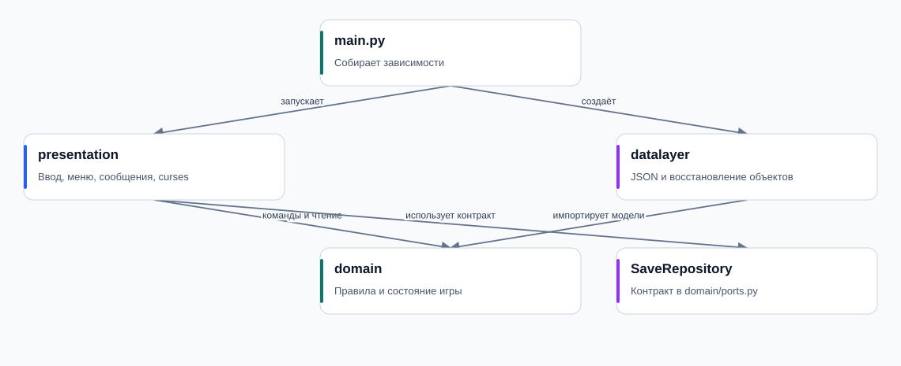

Источники: `main.py`, `domain/ports.py`, `tests/test_architecture.py`

Проект разделён на три слоя. presentation переводит действия человека в команды и рисует состояние. domain решает, что произошло. datalayer переводит объекты в JSON и обратно. main.py создаёт JsonRepository и передаёт его интерфейсу вместе с фабрикой новых сессий.

Стрелки этой схемы показывают сборку и зависимости, а не очередность выполнения. Во время игры presentation вызывает методы репозитория через переданный объект. Сам GameSession не вызывает сохранение. SaveRepository — Protocol: реализация подходит по наличию методов, наследование не требуется.

Архитектурные тесты запрещают домену импортировать curses, json и внешние слои; presentation и datalayer не должны импортировать друг друга. Эти проверки анализируют импорты, но не доказывают отсутствие всех возможных нарушений инкапсуляции.

Исходник Mermaid

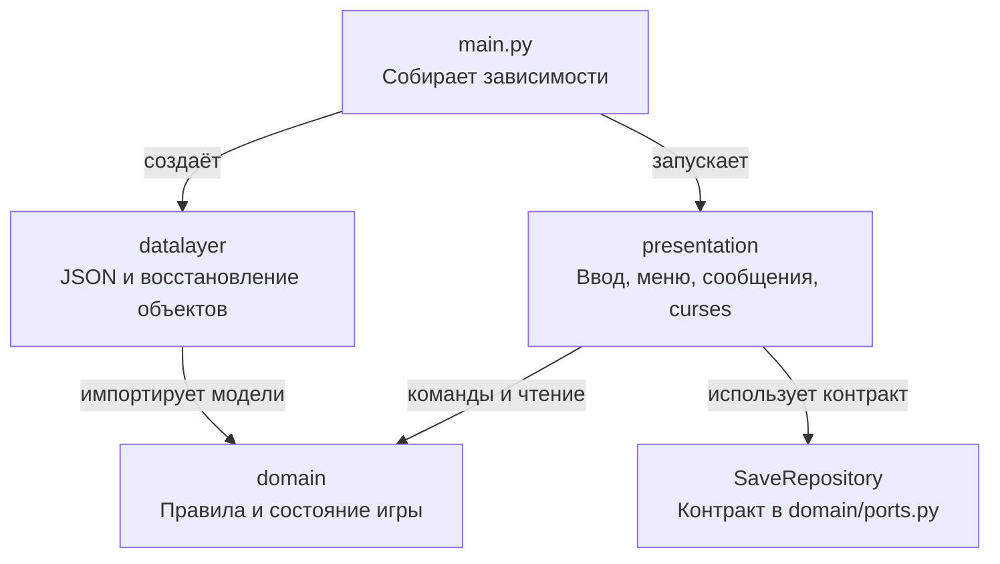

## 2. Жизненный цикл приложения

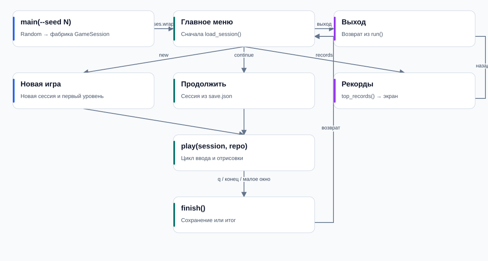

Источники: `main.py`, `presentation/app.py`

run() перед каждым показом меню пытается загрузить сохранение. Продолжение доступно, когда загрузка вернула сессию. Новая игра создаётся через переданную функцию: GameSession(random.Random(args.seed)).

play() сначала проверяет размер терминала, рисует кадр, затем ждёт клавишу. q выходит из текущей игры в меню. Если окно слишком маленькое, приложение ждёт увеличения либо q. В обоих случаях finish() обрабатывает текущее состояние.

PLAYING сохраняется; WON и LOST попадают в рекорды с удалением сохранения. Автоматического сохранения после каждого шага нет. Нормальный выход через меню и завершение процесса — разные пути: аварийное закрытие не проходит через finish().

Исходник Mermaid

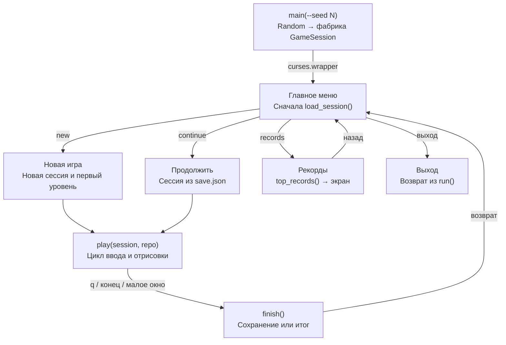

## 3. Один ход: от клавиши до нового кадра

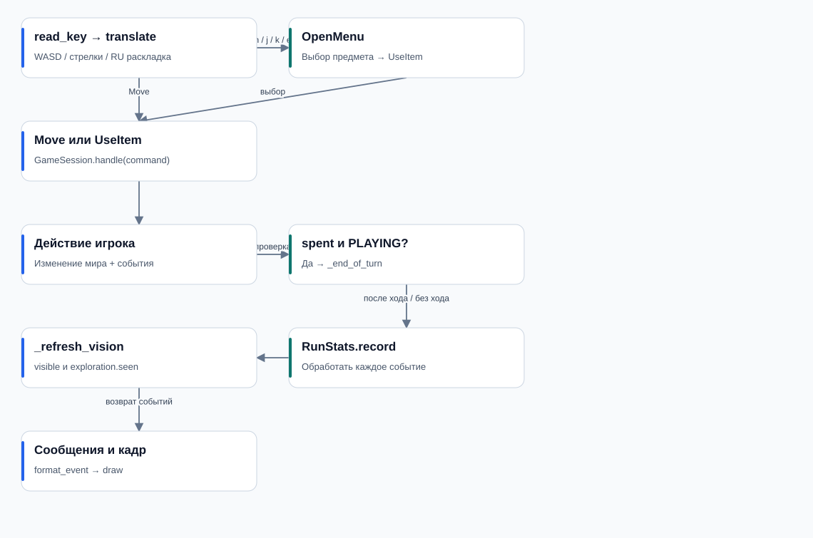

Источники: `presentation/input.py`, `presentation/app.py`, `domain/session.py`

Команда описывает намерение: Move(dx, dy) или UseItem(item_type, slot). Событие описывает уже случившийся факт: Moved, PlayerAttacked, ItemUsed и другие. Состояние меняется внутри сессии, события помогают собрать статистику и сообщения.

После действия игрока мир ходит только при spent=True и состоянии PLAYING. Порядок хода мира: уменьшение длительности эффектов → для каждого врага обновление невидимости → его действие с учётом таймера → проверка смерти игрока. При смерти оставшиеся враги уже не действуют.

Затем handle() учитывает все события и пересчитывает видимость. presentation получает события, превращает их в строки и оставляет последние шесть сообщений; текущий renderer показывает последние два. Следующий кадр рисуется на следующей итерации, а при завершении — перед итоговым экраном.

Открытие и отмена меню, неизвестная клавиша и q не передаются в handle() как игровые действия. В уже завершённой сессии handle() сразу возвращает пустой список.

Исходник Mermaid

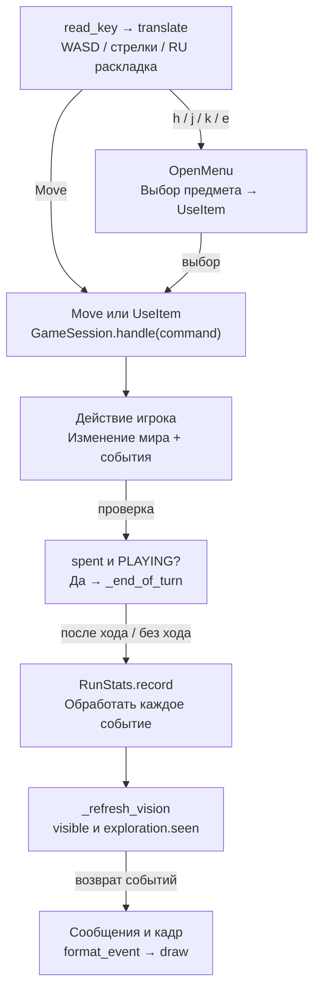

## 4. Движение, удар и переход уровня

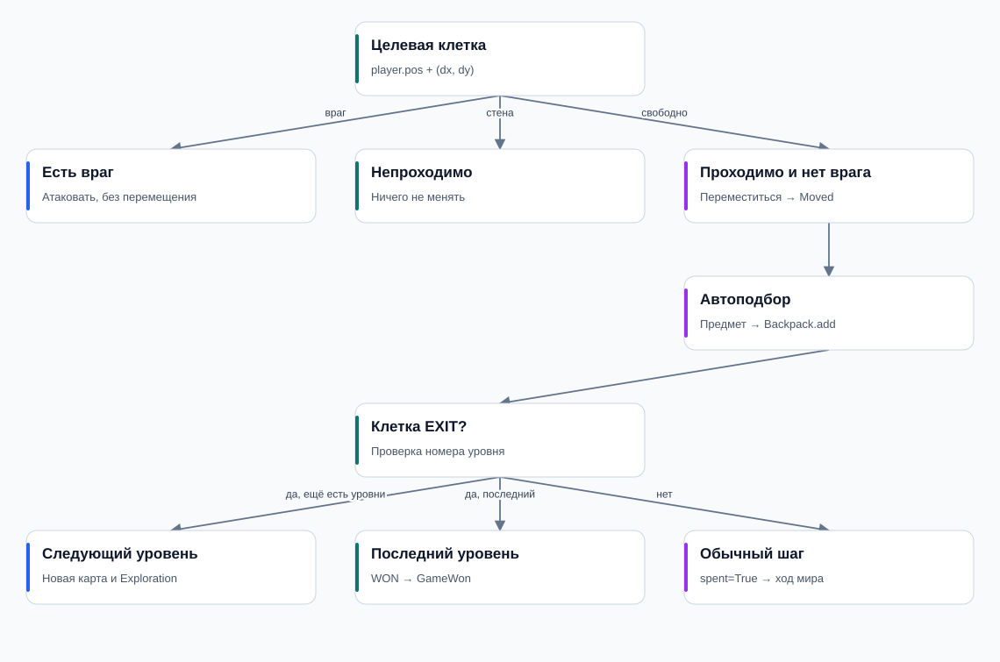

Источники: `domain/session.py::_move_player, _leave_level`

Атака по соседней занятой врагом клетке тратит ход даже при промахе. Игрок не занимает освободившуюся клетку в том же действии. Побеждённый враг удаляется, сокровища сразу зачисляются в backpack.treasure.

Упор в стену ход не тратит. Обычный шаг тратит, включая шаг на предмет при полном рюкзаке: предмет остаётся на полу, появляется BackpackFull. Подбор не является отдельным ходом.

Шаг на выход сначала перемещает игрока и создаёт Moved. Затем генерируется следующий уровень или устанавливается WON. Ветка выхода возвращает spent=False: эффекты не уменьшаются, враги нового уровня не действуют. При переходе сохраняются персонаж, рюкзак, эффекты и статистика, но память исследования заменяется новой.

Исходник Mermaid

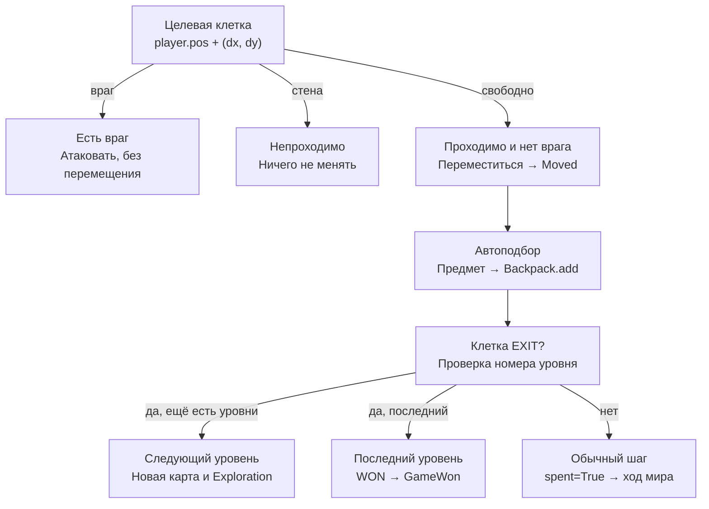

## 5. Модель данных: что хранит игровая сессия

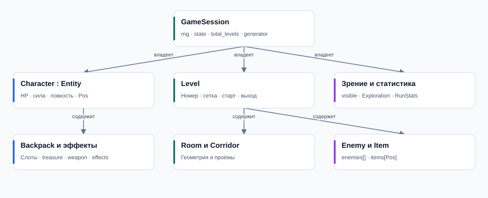

Источники: `domain/models/*`, `domain/session.py`

Entity задаёт общее поведение игрока и врага: alive, attack_power, traits и представление здоровья в блоках. Character добавляет рюкзак, оружие и временные эффекты. Enemy хранит ссылку на неизменяемый EnemySpec и собственные текущие характеристики, таймер и флаги.

Level — модель мира, а не готовый текст экрана. tiles[y][x] отвечает за геометрию, enemies — за существ, items[Pos] — за предмет на клетке. Наличие врага проверяется отдельно от проходимости тайла. Room хранит прямоугольник пола, Corridor — идентификаторы комнат, два проёма и клетки между ними.

Pos — координаты клетки; x растёт вправо, y вниз. Renderer сдвигает координаты на одну клетку из-за рамки. visible — текущий обзор, Exploration.seen — накопленная память текущего уровня. RunStats учитывает события; это отдельный объект, а не вычисление всех показателей из состояния мира.

Исходник Mermaid

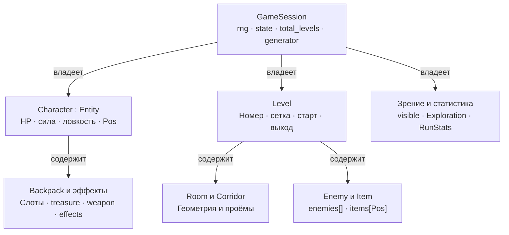

## 6. Генерация уровня: геометрия и проверка

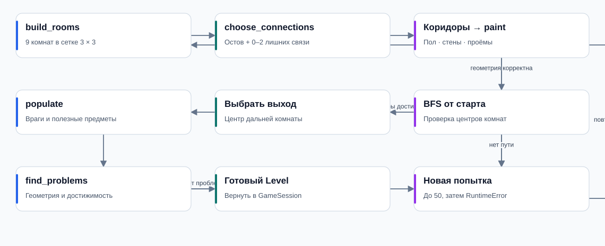

Источники: `domain/generation/*`, `domain/geometry.py`

Размер карты — 78 × 21. В каждой из девяти секций создаётся одна прямоугольная комната. choose_connections() перемешивает возможные связи соседних секций и через объединение компонент строит остовное дерево; дополнительные связи создают обходные маршруты. Коридоры состоят из горизонтальных и вертикальных отрезков.

После paint() выбираются случайная стартовая комната и клетка внутри неё. BFS считает расстояния по проходимым клеткам. Выход размещается в центре другой комнаты с максимальным расстоянием до её центра, а не в самой дальней клетке карты.

populate() исключает стартовую комнату и выход, перемешивает свободные клетки, размещает сначала врагов, затем предметы. Врагов: 3 + (номер − 1). Полезных предметов становится меньше: от 8 до 3 при стандартных 21 уровнях. Гарантированный тип сейчас только еда; другие типы выбираются по весам каталога. Число размещений ограничено доступным местом.

Проверка ищет недостижимые клетки комнат, неверные проёмы, лишние выходы, сущности вне пола и пересечения. Неудача запускает всю генерацию заново. 50 неудачных попыток завершаются исключением.

Исходник Mermaid

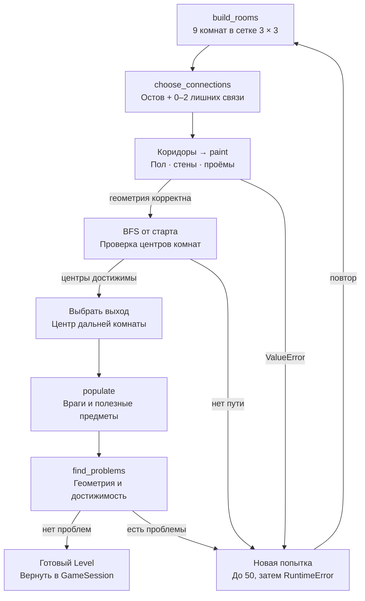

## 7. ИИ врагов: реальный порядок ветвлений

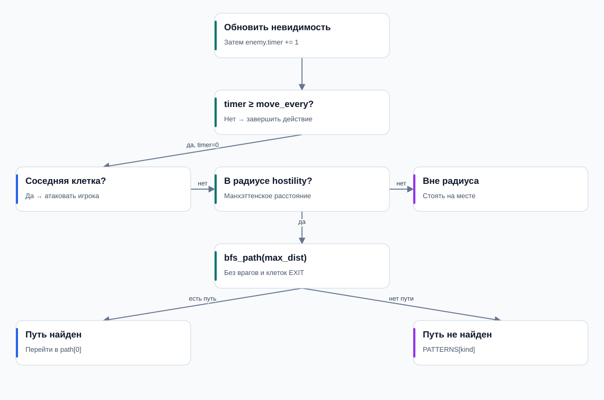

Источники: `domain/session.py::_enemy_turn`, `domain/enemies/*`

В текущем коде у всех трёх видов move_every=2. Поэтому враг пытается двигаться или атаковать раз в два потраченных хода игрока. Обновление невидимости вызывается раньше проверки таймера и происходит каждый потраченный ход мира.

Сначала проверяется соседство по Манхэттену: расстояние 1 означает атаку. Иначе для преследования нужны и подходящее расстояние, и путь не длиннее hostility. BFS учитывает стены, других врагов и запрет вставать на выход. Враги обрабатываются последовательно: перемещение раннего врага влияет на доступность клеток для позднего.

Важная особенность реализации: PATTERNS вызывается внутри ветки радиуса враждебности только при отсутствии пути. За пределами радиуса враги стоят, хотя комментарий behaviors.py описывает паттерны как движение, когда игрока рядом нет. Зомби и вампир используют случайный шаг, привидение — телепортацию по комнате, а в коридоре обычный шаг.

Привидение чередует видимость на 3–6 ходов и невидимость на 4–8. По соседству с игроком оно становится видимым. Невидимость влияет на рисунок врага, но не удаляет его из модели: он занимает клетку и участвует в бою.

Исходник Mermaid

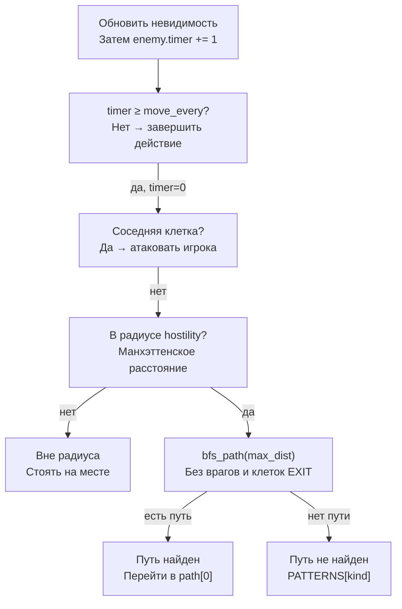

## 8. Бой: попадание, урон, особенности

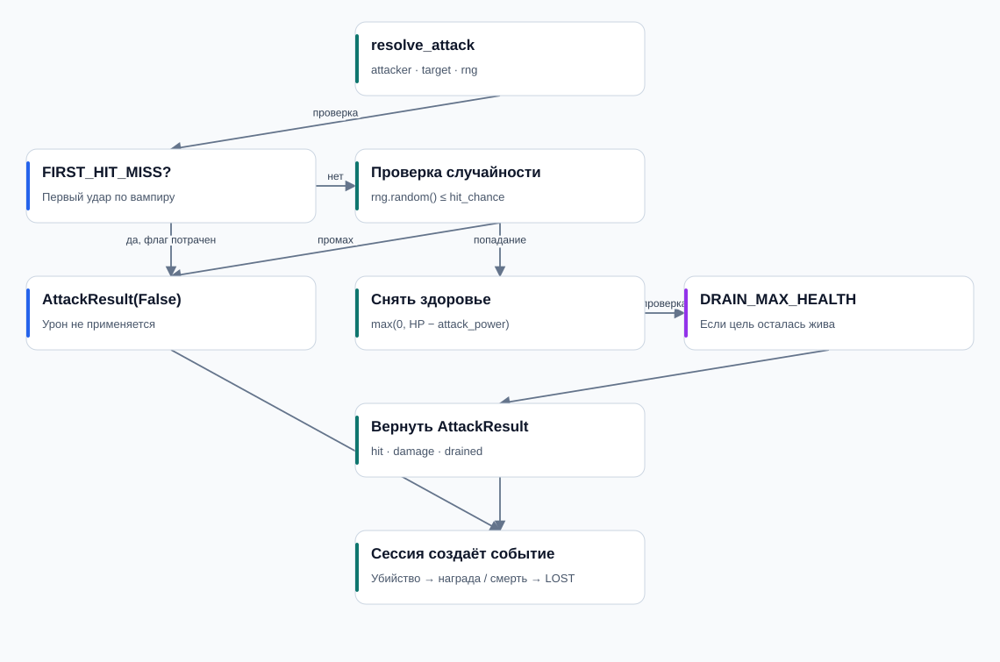

Источники: `domain/combat.py`, `domain/enemies/types.py`

Вероятность попадания: clamp(0.6 + 0.05 × (ловкость атакующего − ловкость цели), 0.1, 0.95). Урон фиксированный: сила атакующего; для игрока добавляется сила оружия. Отдельного случайного броска урона и брони здесь нет.

Первый удар по конкретному вампиру автоматически промахивается до броска случайности; флаг first_hit_spent сохраняет этот факт. При успешной атаке вампира выжившая цель теряет до 10 максимального HP, но максимум не становится ниже 10; текущее HP ограничивается новым максимумом.

Пример с начальными параметрами: игрок имеет 100 HP, силу 20 и ловкость 3; зомби первого уровня — 50 HP, силу 10 и ловкость 2. Вероятность попадания игрока — 65%, урон без оружия — 20. После трёх успешных ударов зомби погибнет, если не учитывать другие изменения.

Характеристики врагов растут по глубине: HP и сила умножаются на 1.08^(номер−1) с округлением; ловкость прибавляет (номер−1)//3. Награда за убийство случайна и зависит от характеристик и hostility. Бой возвращает результат, а удаление врага, начисление награды и события выполняет сессия.

Исходник Mermaid

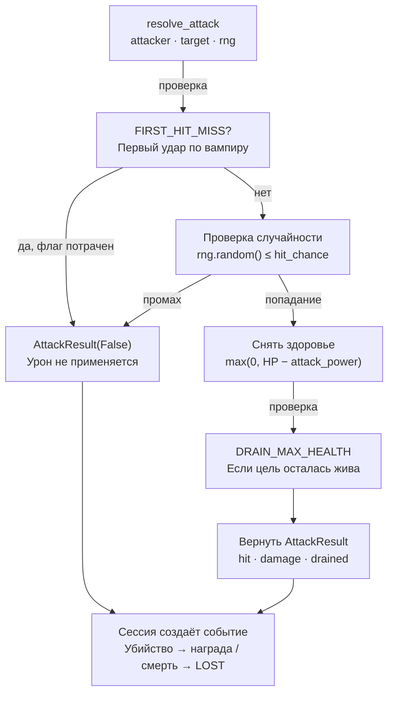

## 9. Предметы, оружие и временные эффекты

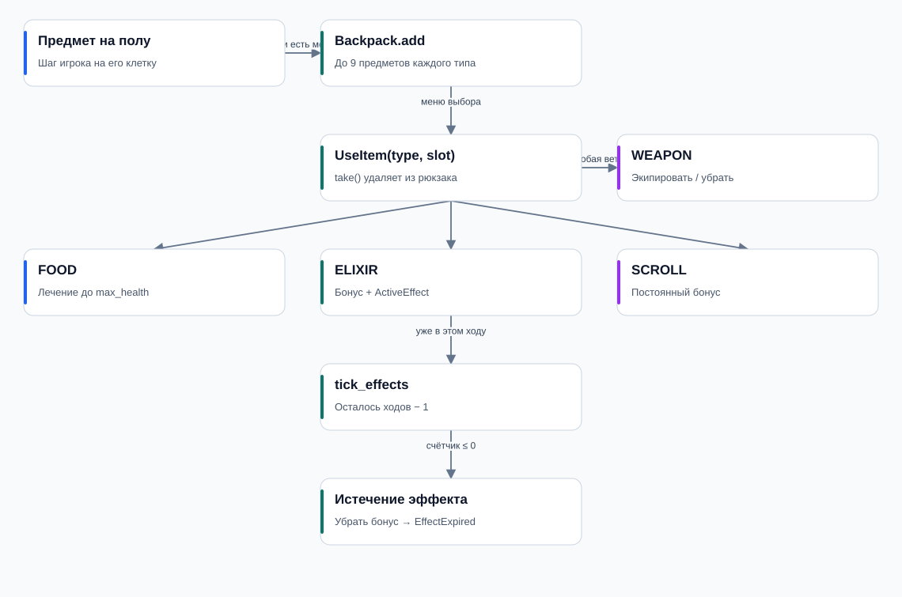

Источники: `domain/session.py::_use_item, _change_weapon`, `domain/models/items.py`

Рюкзак ограничен девятью предметами каждого несокровищного типа, а не девятью суммарно. Сокровища копятся числом. Предмет при успешном подборе удаляется с карты; при нехватке места остаётся.

Еда лечит, свиток изменяет характеристику навсегда, эликсир добавляет бонус и ActiveEffect(stat, amount, turns_left). Новый эликсир сразу попадает в tick_effects() того же хода: длительность 30 после первого применения становится 29 ещё до действия врагов. При окончании бонус снимается; уменьшение максимального HP ограничивает текущее здоровье и оставляет минимум 1.

Выбор оружия извлекает новое оружие из рюкзака и кладёт в player.weapon. Старое падает на первую подходящую соседнюю клетку, иначе применяется запасной вариант под ногами через setdefault(). Если там уже есть предмет, setdefault() его сохраняет, а старое оружие на карту не добавляет — так устроена текущая ветка.

UseItem(WEAPON, None) снимает оружие в рюкзак при наличии места. Успешное применение или смена оружия тратят ход; отсутствующий слот, отсутствие оружия и отказ из-за полного рюкзака — нет.

Исходник Mermaid

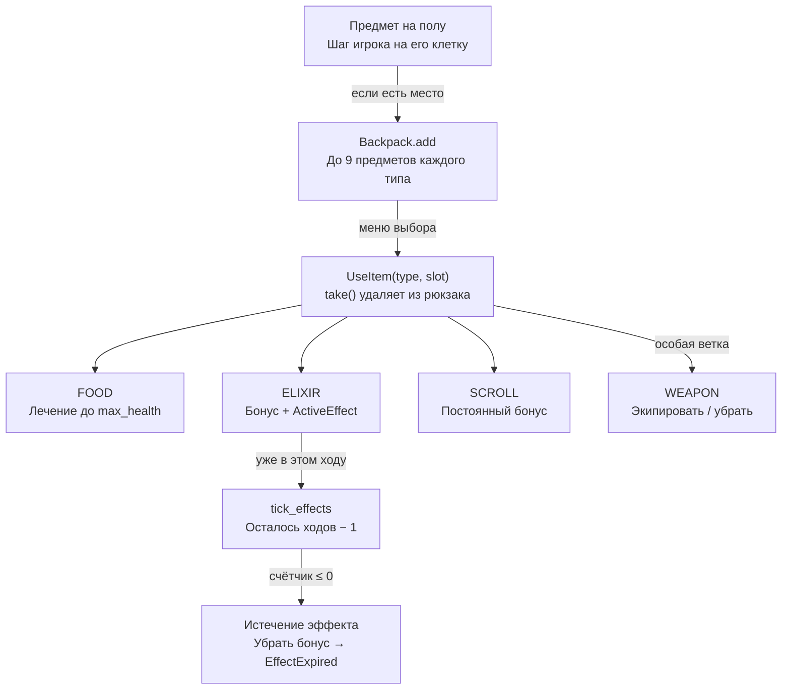

## 10. Туман войны и слои отрисовки

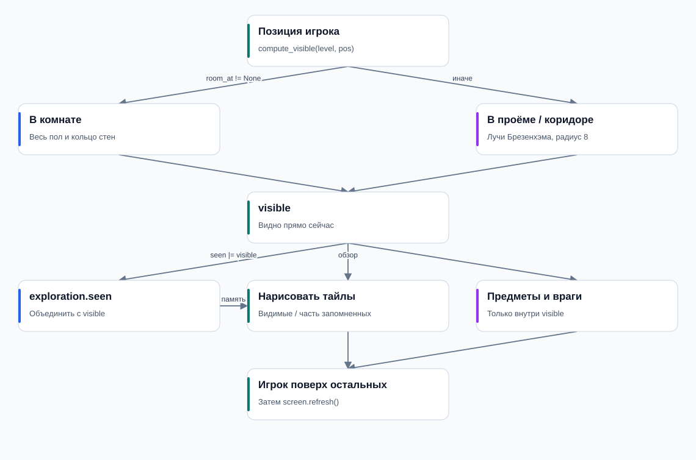

Источники: `domain/visibility.py`, `presentation/renderer.py`, `presentation/theme.py`

Внутри комнаты обзор не ограничивается радиусом: виден её прямоугольник с окружающими стенами и проёмами. Из коридора и проёма лучи идут ко всем клеткам круга радиуса 8. WALL и VOID останавливают луч; сама преграда добавляется в обзор.

seen хранит все ранее виденные позиции, но renderer рисует за пределами текущего обзора только запомненные WALL, DOORWAY и CORRIDOR, приглушённым цветом. Пол, выход, предметы и враги в памяти не показываются. Это различие между сохранённой памятью и её визуализацией.

Порядок рисования: рамка и HUD → тайлы → предметы → видимые и не невидимые враги → игрок. Предмет или существо перекрывает символ тайла. Невидимость привидения и туман войны — независимые проверки.

Исходник Mermaid

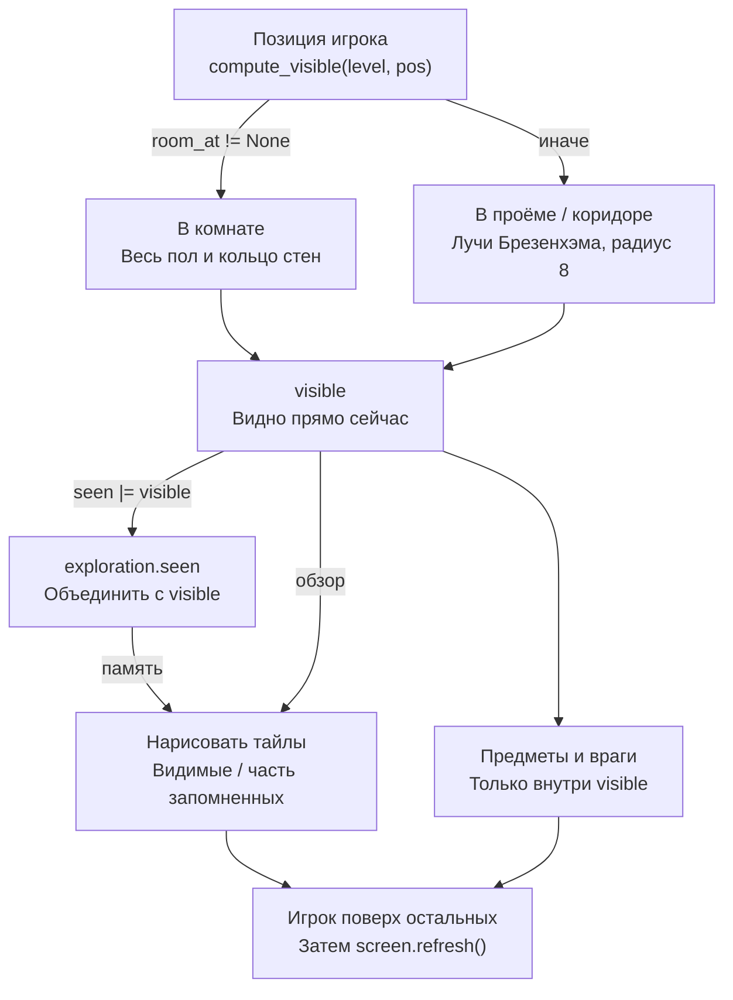

## 11. Сохранение, загрузка и рекорды

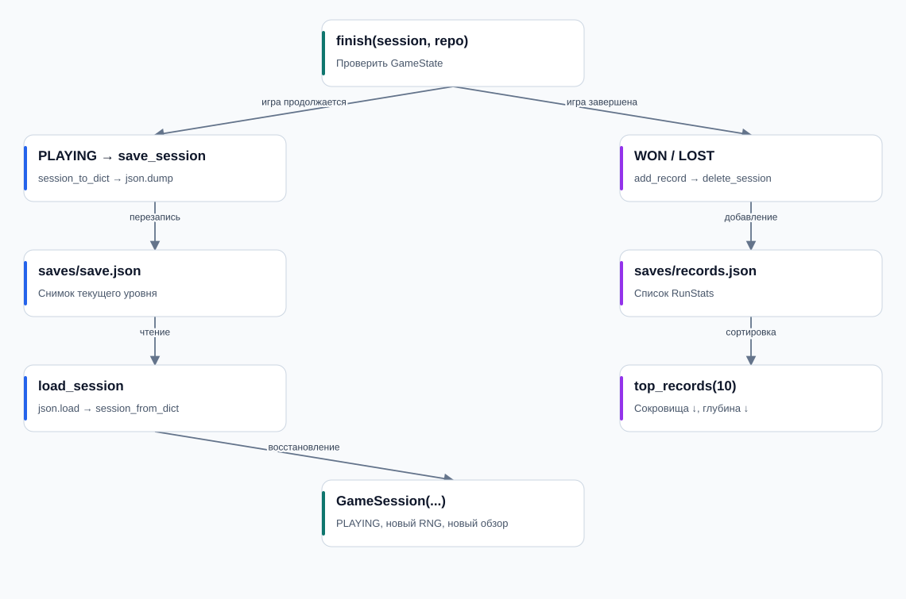

Источники: `presentation/app.py::finish`, `datalayer/*`

Сохраняются total_levels, статистика, персонаж с оружием, рюкзаком и эффектами, геометрия текущего уровня, предметы, враги и exploration.seen. Enum превращаются в строки, Pos — в пары чисел, сетка тайлов — в строки символов. Список предметов на полу хранит пары «позиция + предмет», поскольку JSON не поддерживает Pos в ключах.

Состояние генератора случайных чисел не записывается. После загрузки создаётся новый Random, поэтому продолжение случайных исходов и будущих уровней не повторяет непрерывную игру. Также не сохраняются invisible и phase_turns врагов: привидение восстанавливается с исходными значениями этих полей. visible вычисляется заново из уровня и позиции; state заново становится PLAYING. Для штатных сохранений это ожидаемо, поскольку сохраняются только незавершённые игры.

Обычные ошибки чтения и восстановления в load_session() дают None; это не универсальная проверка всех структурно повреждённых файлов. Рекорды сортируются по treasure, при равенстве по level_reached, по убыванию. RunStats.treasure увеличивается на EnemyKilled; подбор предмета типа TREASURE сейчас не увеличивает этот счётчик, хотя Backpack умеет такой предмет принять.

SaveRepository описывает четыре метода, но finish() дополнительно вызывает delete_session(), отсутствующий в Protocol. JsonRepository этот метод имеет, поэтому текущая сборка работает. Здесь описано расхождение контракта и использования без изменения кода.

Исходник Mermaid

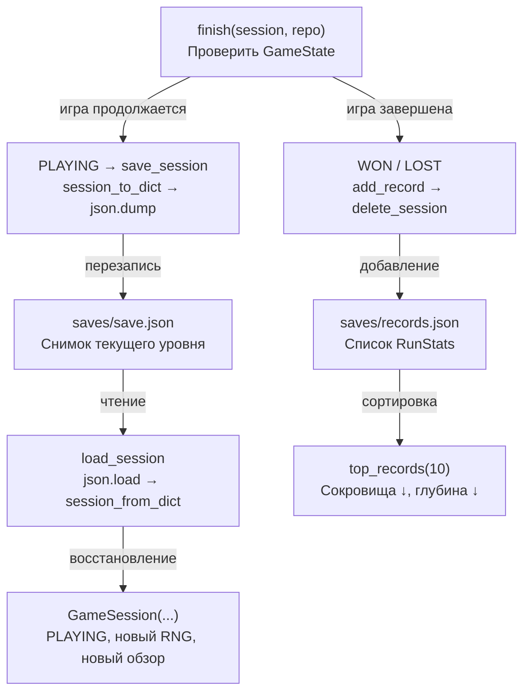

## Практический маршрут по исходникам

1. `main.py` и `presentation/app.py`: найдите создание зависимостей, цикл игры и finish().
2. `domain/commands.py`, `domain/events.py`, `domain/session.py`: проследите один Move от намерения до событий.
3. `domain/models/`: найдите данные, которые меняет этот ход.
4. `domain/combat.py`, `domain/enemies/`: разберите удар и ответ противника.
5. `domain/generation/`: проследите появление следующего уровня.
6. `domain/visibility.py`, `presentation/renderer.py`: сравните существующий мир и видимый кадр.
7. `datalayer/serializers.py`: сопоставьте объекты и поля JSON.
8. `tests/test_session.py`, `test_combat.py`, `test_generation.py`, `test_items_and_effects.py`, `test_playthrough.py`: прочитайте сценарии как примеры правил. `test_architecture.py` отдельно фиксирует границы слоёв.

## Что в старом описании уже не соответствует коду

В ARCHITECTURE.md сохранения и рекорды указаны как неготовые, туман войны отсутствует в списке готового, а привидение отнесено к будущим задачам. Всё это уже есть в текущих файлах. Там же описан move_every=1 для вампира, тогда как SPECS сейчас задаёт 2. Паттерны движения вне зоны игрока заявлены в комментариях, но фактическая ветка вызова расположена внутри зоны hostility. Для понимания поведения ориентируйтесь на код и приведённые выше схемы.
